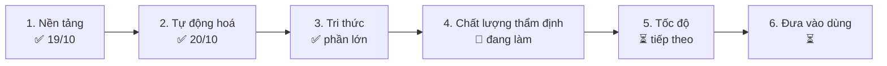

# Lộ trình (Roadmap) – Website thẩm định PCCC
Cập nhật: 2026-10-21. File này trả lời "đang ở đâu, còn gì". Chi tiết kỹ thuật: `TIEN_DO.md`; nhật ký từng mốc: `LICH_SU.md`.
Ký hiệu: ✅ xong · 🔄 đang làm · ⏳ chưa làm · 👤 người dùng phải làm.

## Bức tranh tổng

Quy trình một lần thẩm định (đã chạy được):
`PDF → đọc hồ sơ (A0) → chọn bảng (KT xây dựng + A/B hệ thống) → agent từng hạng mục chạy song song → rà soát chéo → hướng dẫn thẩm định → xuất PDF comment + Word`

## Giai đoạn 1 – Nền tảng ✅ (2026-10-19)
- ✅ 58 bảng đối chiếu → `data/bang/*.json`, mẫu Word.
- ✅ `shared/` (schema, agent, chọn bảng, chia mục, prompt, gộp, đổi font VNI).
- ✅ Web 5 bước + viewer khung đánh số; runner :8787; 21 agent + lệnh `/tham-dinh`.
- ✅ Chạy thật Hoàng Anh 1: 34/34 job, khớp báo cáo tay.

## Giai đoạn 2 – Tự động hoá ✅ (2026-10-20)
- ✅ Chọn PDF là tự chạy hết; kéo thả nhiều file, tự gộp theo công trình.
- ✅ Chế độ Hỗn hợp Claude + Gemini, Gemini lỗi tự chuyển Claude; tự chờ khi hết hạn mức.
- ✅ Xuất PDF bằng comment, xuất Word; `chay.bat` một cú bấm.

## Giai đoạn 3 – Tri thức ✅ phần lớn
- ✅ Nạp NĐ 105/2025, NĐ 347/2026, QCVN 10:2025, QCVN 06 (Điều 4–7, PL H), TCVN 7568-14:2025.
- ✅ Agent tự học + kiểm soát viên tự duyệt; `knowledge/hoc` 35 ghi chú; học xong scan 2024–2026.
- ⏳ 👤 Xác nhận QCVN 02 trạm bơm còn hiệu lực sau QCVN 10:2025 (ghi chú `08bf60f5653f`).
- ⏳ 👤 Cấp quyền thư mục hồ sơ 2017–2023 nếu muốn học thêm.

## Giai đoạn 4 – Chất lượng thẩm định 🔄 (đang làm)
- ✅ Bảng Đồng Nai A1–A26 + B1–B14 (hệ thống); bảng `KT*` (xây dựng, NĐ 105 Điều 6); hai kết quả riêng.
- ✅ Agent Hướng dẫn thẩm định; chạy thật Karaoke Hoàng Yến (phần hệ thống).
- ⏳ Chạy thật phần xây dựng (KT15) trên Karaoke bằng AI.
- ⏳ Soát bảng KT cũ còn điều khoản lỗi thời không.
- ⏳ Kiểm dòng B3#63 (nghi sai số 70 mm).
- ⏳ Giảm dòng hướng dẫn thừa (226 dòng > 153 dòng cần).
- ⏳ Cho agent hướng dẫn đọc ảnh trang bản vẽ (hiện chỉ đọc chữ).
- ⏳ 👤 Mở PDF xuất ra bằng Acrobat/Edge, kiểm khung + comment.
- ⏳ 👤 Rà 9 dòng CHƯA ĐẠT của Karaoke và các phát hiện mới HA1.

## Giai đoạn 5 – Tốc độ ⏳ (tiếp theo, xem `BAO_CAO_TIEN_DO.md`)
Đọc hồ sơ mất ~2,5 phút và chạy tuần tự; cả lần thẩm định 20–25 phút.
- ⏳ Lưu đệm kết quả đọc hồ sơ theo hash PDF (rẻ nhất, làm trước).
- ⏳ Giữ phiên khi F5 (nạp lại từ `runner/work/<phiên>`).
- ⏳ Ghi thời gian từng pha vào log.
- ⏳ Chia đọc hồ sơ thành job song song, hoặc đọc bằng Gemini API.

## Giai đoạn 6 – Đưa vào dùng ⏳
- ⏳ 👤 Đổi token Claude đã lộ (`claude setup-token`).
- ⏳ 👤 Bật GitHub Pages hoặc Netlify.
- ⏳ 👤 Dán key Gemini API để chạy 10 luồng.
- ⏳ Thêm bảng chống tụ khói, thang máy chữa cháy, chống sét khi có bảng mới.
- ⏳ Test tự động cho web và runner.

## Ý tưởng chờ (chưa xếp giai đoạn)
- Tự chạy `chay.bat` khi bật máy.
- Các mục "chưa" trên sơ đồ `so_do/so_do_kien_truc_ngang.html` (hook soát kết quả, `/kiem-tra`, `/nap-kien-thuc`, đo hình học tự động).
