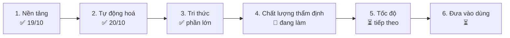

# Lộ trình (Roadmap) – Website thẩm định PCCC
Cập nhật: 2026-10-21 (chiều). File này trả lời "đang ở đâu, còn gì". Chi tiết kỹ thuật: `TIEN_DO.md`; nhật ký từng mốc: `LICH_SU.md`.
Ký hiệu: ✅ xong · 🔄 đang làm · ⏳ chưa làm · 👤 người dùng phải làm.

## Bức tranh tổng

Quy trình một lần thẩm định (đã chạy được):
`PDF → đọc hồ sơ (A0) → chọn bảng (KT xây dựng + A/B hệ thống) → agent từng hạng mục chạy song song → rà soát chéo → hướng dẫn thẩm định → xuất PDF comment + Word`

## Giai đoạn 1 – Nền tảng ✅ (2026-10-19)
- ✅ 58 bảng đối chiếu → `data/bang/*.json`, mẫu Word.
- ✅ `shared/` (schema, agent, chọn bảng, chia mục, prompt, gộp, đổi font VNI).
- ✅ Web 5 bước + viewer khung đánh số; runner :8787; 21 agent + lệnh `/tham-dinh`.
- ✅ Chạy thật Hoàng Anh 1: 34/34 job, khớp báo cáo tay.

## Giai đoạn 2 – Tự động hoá ✅ (2026-10-20)
- ✅ Chọn PDF là tự chạy hết; kéo thả nhiều file, tự gộp theo công trình.
- ✅ Chế độ Hỗn hợp Claude + Gemini, Gemini lỗi tự chuyển Claude; tự chờ khi hết hạn mức.
- ✅ Xuất PDF bằng comment, xuất Word; `chay.bat` một cú bấm.

## Giai đoạn 3 – Tri thức ✅ phần lớn
- ✅ Nạp NĐ 105/2025, NĐ 347/2026, QCVN 10:2025, QCVN 06 (Điều 4–7, PL H), TCVN 7568-14:2025.
- ✅ Agent tự học + kiểm soát viên tự duyệt; `knowledge/hoc` 35 ghi chú; học xong scan 2024–2026.
- ⏳ 👤 Xác nhận QCVN 02 trạm bơm còn hiệu lực sau QCVN 10:2025 (ghi chú `08bf60f5653f`).
- ⏳ 👤 Cấp quyền thư mục hồ sơ 2017–2023 nếu muốn học thêm.

## Giai đoạn 4 – Chất lượng thẩm định 🔄 (đang làm)
- ✅ Bảng Đồng Nai A1–A26 + B1–B14 (hệ thống); bảng `KT*` (xây dựng, NĐ 105 Điều 6); hai kết quả riêng.
- ✅ Agent Hướng dẫn thẩm định; chạy thật Karaoke Hoàng Yến (phần hệ thống).
- ✅ Chạy thật phần xây dựng (KT15) bằng AI trên Karaoke Hoàng Anh 2 (116 trang, `ket_qua/karaoke_hoang_anh_2/`): 147 dòng = ĐẠT 38, CHƯA ĐẠT 3 (cửa D3, D2 kho mở ra hành lang không phải cửa chống cháy), CẦN XÁC NHẬN 25, KHÔNG ÁP DỤNG 81; ~728 nghìn token subagent Sonnet. Chưa kiểm bằng hình (máy thiếu pdftoppm).
- ✅ Soát bảng KT cũ: sửa 21 dòng trích TCVN 5687:2010 (đã bị thay bằng 5687:2024). Còn danh mục đầu bảng (`dau_bang`) ghi NĐ 136/2020, TCVN 3890 nhưng không đưa vào prompt.
- ✅ Dòng B3#63: 70 mm đúng theo Đ 7.19 TCVN 4513:1988 (hai ghi chú học khớp nhau).
- ✅ Hướng dẫn thừa: lần Hoàng Anh 2 ghi đúng 31/31 dòng khi prompt dặn "không thêm dòng ngoài danh sách". Chưa áp lại lên Karaoke Yến.
- 🔄 Cho agent xem ảnh trang bản vẽ: `pdftoppm` không có nên dựng ảnh bằng PyMuPDF (`pymupdf`, đã cài) rồi `Read` ảnh. Đã thử tay trên Hoàng Anh 2: hình cho thấy 3 dòng CHƯA ĐẠT cửa D3 là sai (D3 là cửa cuối hành lang ra thang ngoài trời CT2) → hạ xuống CẦN XÁC NHẬN (còn lại 0 CHƯA ĐẠT, 28 CẦN XÁC NHẬN).
- ✅ `chuan-bi` và web (`/phien`, chạy nền) tự dựng ảnh trang `anh/trang_N.png` bằng `scripts/dung_anh.py` (116 trang: 15 giây, 30 MB, thư mục bị ignore); prompt dặn agent mở ảnh trước khi kết luận CHƯA ĐẠT dựa vào vị trí cửa, thang, đèn. Không có Python hoặc PyMuPDF thì bỏ qua, chạy bằng chữ. **Chưa chạy lại thẩm định để đo chất lượng và token khi agent mở ảnh.**
- ⏳ 👤 Mở PDF xuất ra bằng Acrobat/Edge, kiểm khung + comment.
- ⏳ 👤 Rà 9 dòng CHƯA ĐẠT của Karaoke và các phát hiện mới HA1.

## Giai đoạn 5 – Tốc độ ⏳ (tiếp theo, xem `BAO_CAO_TIEN_DO.md`)
Đọc hồ sơ mất ~2,5 phút và chạy tuần tự; cả lần thẩm định 20–25 phút. Token tốn nhiều khi chạy `/tham-dinh` trong app.
- ✅ Mọi agent dùng Sonnet (đã thử Haiku cho 8 mục tra bảng rồi bỏ sau khi đo); runner truyền `--model` theo job, tự học ép Sonnet. Chế độ Hỗn hợp giao 8 mục tra bảng cho Gemini. Phiên điều phối `/tham-dinh` không tự đọc bản vẽ.
- ✅ Chạy thử 8 job Haiku trên Karaoke (`ket_qua/karaoke_haiku/so_sanh.md`): 104 dòng, khớp 83 (80%), không bỏ sót dòng; giữ 4/5 CHƯA ĐẠT cũ, thêm 1 (nguồn 1 h/2 h < 3 h); Haiku thận trọng hơn (9 dòng ĐẠT → CẦN XÁC NHẬN vì thiếu Isc, công suất). Tổng 894 nghìn token, trung bình 112 nghìn/job.
- ✅ Đo Haiku và Sonnet cùng 8 job (`BAO_CAO_TIEN_DO.md`): Haiku rẻ hơn ~16% nhưng gấp 2,2 lần token, chậm gấp 1,9 lần; Sonnet khớp lần cũ 86% so với 79%.
- ✅ Thử nhúng chữ trang liên quan vào prompt: đo thấy TĂNG 24% token (`BAO_CAO_TIEN_DO.md`), đã tắt mặc định. ⏳ Còn thử: cắt cột "Quy định" dài trong prompt, giảm số lượt đọc ảnh.
- ✅ Đã gỡ TCVN 3890 và TCVN 5687:2010 khỏi bảng đối chiếu (411 + 21 ô), tri thức, skills, agent (`data-build/bo_tcvn3890.py`; lint ghi chú học vẫn đổi viện dẫn cũ sang bản mới).
- ✅ Xem hình bản vẽ: dùng PyMuPDF thay poppler (xem dòng ảnh trang ở trên).
- 🔄 Đọc hồ sơ (A0) bằng Gemini web ở chế độ Hỗn hợp (Playwright ẩn, tab cách nhau 4–7 s, lỗi thì chuyển Claude). Chạy thử 04:33: cookie Gemini đã hết hạn (chế độ khách) nên A0 tự chuyển Claude, xong 66 s; chưa thấy Gemini đọc A0 thành công. ⏳ 👤 Xuất lại cookie Gemini (Cookie-Editor → JSON) rồi nạp ở bước 1.
- ✅ Đệm câu trả lời job theo nội dung prompt (`runner/src/dem.ts`, gồm A0): hồ sơ trùng thì không gọi AI. Chưa kiểm trên web thật.
- 🔄 Giữ phiên khi F5: chưa lưu giao diện; nạp lại cùng PDF thì các job lấy từ đệm gần như tức thì.
- ✅ Log thời gian từng job (`runner/runner.log`: "xong <job> N s", "dùng đệm").
- ⏳ Chia đọc hồ sơ thành job song song: cân nhắc không làm, vì mỗi phần vẫn đọc cả hồ sơ nên token tăng gấp nhiều lần.

## Giai đoạn 6 – Đưa vào dùng ⏳
- ⏳ 👤 Đổi token Claude đã lộ (`claude setup-token`).
- ⏳ 👤 Bật GitHub Pages hoặc Netlify.
- ⏳ 👤 Dán key Gemini API để chạy 10 luồng.
- ⏳ Thêm bảng chống tụ khói, thang máy chữa cháy, chống sét khi có bảng mới.
- ⏳ Test tự động cho web và runner.

## Công cụ vận hành
- ✅ Agent `pccc-tu-sua` (`.claude/agents/pccc-tu-sua.md`) + `scripts/day_github.sh`: sửa lỗi test/build/runner, kiểm bí mật, commit, push bằng tài khoản taelomuhicd84 (git local `credential.https://github.com.username`). Không force push, không tự cấp quyền; push cần đăng nhập thì dừng và báo.

## Ý tưởng chờ (chưa xếp giai đoạn)
- Tự chạy `chay.bat` khi bật máy.
- Các mục "chưa" trên sơ đồ `so_do/so_do_kien_truc_ngang.html` (hook soát kết quả, `/kiem-tra`, `/nap-kien-thuc`, đo hình học tự động).
